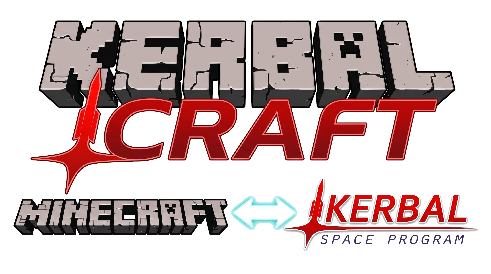
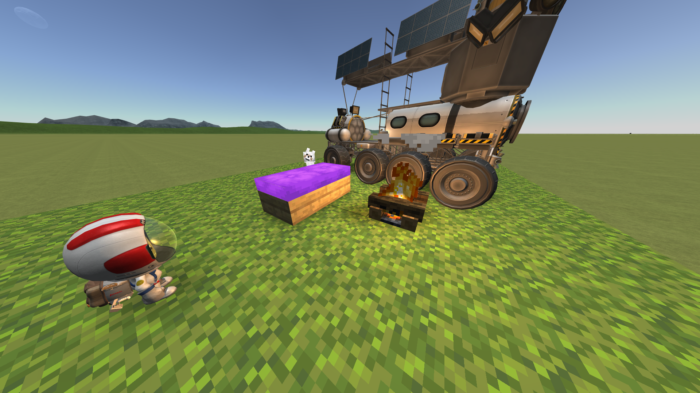

# KerbalCraft

<p align="center"></p>

**English** | [Русский](README.ru.md)

**Minecraft right inside the Kerbal Space Program window.** Step out onto the Mun and you are Steve:
blocks, a pickaxe, torches, TNT, crafting, all real; but the sky, the sun, shadows, rockets and the ground
itself come from KSP. You can build a house on Minmus, jump seven blocks high in the Mun's gravity, kick a
rocket so it tips over, and blow it up with TNT.

The project is based on [SkyCraft](https://github.com/chasmlol/SkyCraft) (Minecraft ⇄ Skyrim, MIT): the Fabric
mod and the shared-memory protocol come from it, while the "host" (what SkyCraft implemented as an SKSE plugin
for Skyrim) was rewritten from scratch as a KSP plugin in C#.



> **Status: 0.1.** Launched and tested in-game by the author on Windows, with KSP 1.12.x and Minecraft 26.3.
> Verified: the Java↔C# protocol is in sync (`tools/check_protocol.py`) and the coordinate-system math passes
> (`tools/test_frame_math.py`). This is an early version: bugs are possible, especially on other setups.
> Report bugs and observations in Issues.

## Features

| | |
|---|---|
| World | Minecraft blocks are drawn as **Unity meshes inside the KSP scene**: they are lit by KSP's sun, cast and receive shadows, and are occluded by rocket parts and terrain. Not an overlay. |
| Planets | A "site" is a flat patch of the Minecraft world tangent to the planet's surface at the point where you stepped out. Structures are stored in the Minecraft world and wait for you in place; each planet and each site has its own. |
| Gravity | The body's gravity from KSP scales Steve's physics: on the Mun (1.63 m/s²) the same jump is about 6× higher, on Minmus (0.49) about 20×. Falls: the safe height grows, and fall damage depends on speed. |
| Terrain | The ground under your feet is real KSP terrain (rays against loaded colliders, and beyond that the planet's height function). Hills, craters, slopes. |
| Rockets | Every rocket part nearby is a "stand" entity in Minecraft with a hitbox. A hit applies an **impulse to the part** (`AddForceAtPosition`): a kick topples the rocket. Long parts are split into several hitboxes. |
| Explosions | TNT (and anything else that explodes in Minecraft) pushes rocket parts with a radial impulse. |
| Collisions | Steve walks on hulls and stands on landing legs (the parts' collider triangles). Placed blocks are real obstacles for rovers and kicked rockets (BoxColliders). |
| Hazards | A part hitting Steve at speed, and the exhaust of a running engine, deal damage in hearts. |
| Water | Kerbin's oceans: Steve can swim; the water level is KSP's real sea level. |
| Boarding | Look at a rocket and press `G` to become the pilot of that ship again. |
| Everything else | Crafting, inventory, the pause menu, chat, multiplayer over the network (e4mc): regular Minecraft 26.3. |

## Controls

* **Insert**: enter / exit Steve mode (the ship must be on the ground or floating; EVA works too).
* **Esc**: Minecraft pause menu. **G**: board the ship you are looking at.
* Everything else works as in Minecraft (WASD, space, LMB to hit/dig, RMB to place, E for inventory, 1–9, F5…).
* In Steve mode KSP's controls are locked (`InputLockManager`) and the cursor is captured.

Starting kit (SkyCraft heritage + space): iron armor, stone, logs, glass, ladders, doors, lanterns, a crafting
table, a bucket of water, arrows, golden apples and **16 TNT with a flint and steel**.

## Installation

Requirements: **Windows**, KSP 1.12.x, a Microsoft account with Minecraft: Java Edition.

1. Unpack `KerbalCraft-<version>.zip` into your KSP folder (it creates `GameData/KerbalCraft/…`).
2. Start KSP. From the main menu, the plugin unpacks and launches Minecraft by itself (portable Prism
   Launcher). On first launch, sign in with your Microsoft account. Prism downloads Minecraft 26.3 and Java.
3. In flight, land the ship and press **Insert**.

Without the bundle: put the `kerbalcraft-fabric-<version>.jar` mod and Fabric API into your own Minecraft 26.3
and launch it manually (`-Dkerbalcraft.startHidden=true` hides the window).

## Building from source

```
python tools/check_protocol.py                       # Proto.cs ⇄ Proto.java, memory layout
python tools/test_frame_math.py                      # coordinate systems

# KSP plugin (requires a KSP 1.12.x install for references to Assembly-CSharp/UnityEngine)
dotnet build ksp/KerbalCraft.csproj -c Release -p:KSPDir="C:\Games\KSP"
#   -> ksp/GameData/KerbalCraft/Plugins/KerbalCraft.dll

# Minecraft mod
cd fabric && gradlew build                           # or tools\launch_minecraft.bat for the dev client

# shaders (optional, but prettier): see ksp/Unity/Editor/BuildShaderBundle.cs
# release
powershell -File tools\package.ps1 -KspDir "C:\Games\KSP" -ShaderBundle path\to\kerbalcraft.shaders
```

`ksp/src/Proto.cs` is **generated** from `Proto.java` (`tools/gen_proto_cs.py`). Do not edit it by hand.

### Shaders

Without `GameData/KerbalCraft/Shaders/kerbalcraft.shaders`, the plugin uses KSP's shaders (`KSP/Alpha/Cutoff`,
…): everything still renders, but without biome tints (grass is grey), ambient occlusion, or Minecraft light
levels. The bundle is built in Unity **2019.4.18f1** from the three `.shader` files in `ksp/Unity/Shaders`
(menu *KerbalCraft → Build shader bundle*). No prebuilt bundle is included in the repository, and it cannot be
built without Unity.

## Settings

`GameData/KerbalCraft/KerbalCraft.cfg`: keys, `mouseScale`, `kickImpulse` (kick strength),
`explosionImpulse`, `tetherMeters`, `overlayScale` (for 4K), radii, and so on. All keys are optional.

## Known risks (check these first)

These spots were written from memory of the KSP/Unity APIs. Some have been verified in-game, but not all:

1. **C# build**: typos and API name mismatches are possible (`ControlTypes.*`, `GameEvents.onHideUI`,
   `ScaledSpace.LocalToScaledSpace`…). No compiler was available in the development environment.
2. **Camera** (`Pose.cs`, `CameraDriver`): replacing the position and rotation of KSP's cameras in
   `Camera.onPreCull`, matched by the names `Camera 00/01`, `Camera ScaledSpace`, `GalaxyCamera`. If the sky or
   planet renders incorrectly, check the camera names in your version.
3. **Mouse speed**: `Input.GetAxisRaw("Mouse X")` in KSP may not return pixels; tune `mouseScale`.
4. **Engine exhaust direction** (`Hazards.cs`): exhaust is assumed to flow along `thrustTransform.forward`. If you
   take damage from the front of an engine, flip the sign.
5. **Mirroring**: Minecraft is right-handed, Unity is left-handed; the render root uses `LookRotation` and
   `localScale.x = -1`. If the world looks mirrored (text reversed), check this conversion (`SiteFrame.cs`,
   `WorldRenderer.cs`).
6. **Static block colliders** move with the site (planet rotation), which PhysX treats as "moving static". If this
   causes problems, set `blockColliders = false`.
7. **EVA anchor mode** (`followWithEva`) is experimental and disabled.

## What is missing compared to SkyCraft

Skyrim skills and combat, Discord presence, terrain destruction (`TRI_DIGGABLE`): PQS terrain cannot be
"punched through". The digging code is inherited but inactive (the host does not mark triangles). Voxels
(`ColBlock`) are sent only for terrain; ship hulls are sent only as triangles (the player feels them, but thrown
items and arrows do not). Items on the ground fall with Kerbin's gravity. Minecraft's time of day is not synced
(lighting comes from KSP).

For implementation details, see [`docs/DESIGN.md`](docs/DESIGN.md). Licensed under MIT; see also
`THIRD-PARTY-NOTICES.md`. This project is not affiliated with Mojang, Microsoft, Squad, Take-Two or Intercept
Games.
